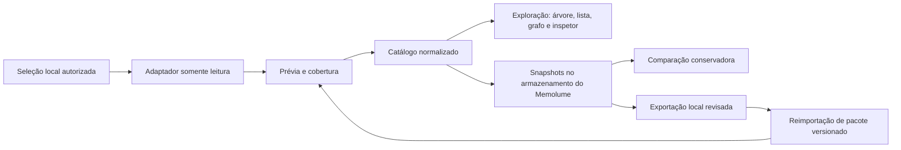

# Arquitetura proposta

Estas são fronteiras propostas pela especificação, ainda sem implementação. Stack, armazenamento e empacotamento serão escolhidos após validar uma fonte.

## Fronteiras

| Módulo | Contrato observável |
| --- | --- |
| Adaptadores | Declarar formatos, versões, capacidades e tipos; retornar itens, relações explícitas, evidências, cobertura e erros por fonte. |
| Catálogo | Preservar identidade e modalidade; reimportação idêntica não duplica registros. |
| Busca e projeções | Gerar árvore real, lista equivalente e grafo do mesmo conjunto com estado compartilhado. |
| Exploração | Manter seleção, filtros, snapshot, histórico de navegação e posições fixadas. |
| Snapshots | Registrar observação, cobertura, consistência e versão do adaptador; preservar a última coleta válida. |
| Comparação | Usar identidade nativa confiável; expor ambiguidade e limitar conclusões quando a cobertura for incompleta. |
| Portabilidade | Exportar e importar pacotes versionados com registros, relações, evidências incluídas e omissões. |
| Armazenamento próprio | Guardar dados do Memolume e permitir sua remoção sem alterar arquivos originais. |

## Contrato de fonte

Uma fonte identifica modalidade, seleção autorizada, versão do adaptador, capacidades, status e última leitura bem-sucedida. A leitura distingue sucesso completo, parcial e falha. Capacidades ausentes carregam um motivo; não são preenchidas por adivinhação.

Hash de conteúdo identifica uma versão. Identidade estável depende do contrato da fonte; correspondências ambíguas exigem indicação explícita. A primeira coleta não fornece história anterior por si só.

## Estados de experiência

Importação em andamento; fonte vazia; leitura parcial; fonte indisponível; formato incompatível; busca sem resultado; origem ausente; origem inacessível; snapshot antigo; comparação inconclusiva; seleção fora dos filtros. Cada estado deve explicar o ocorrido e uma ação disponível.

## Decisões abertas

Escolha do primeiro adaptador real, stack do aplicativo, plataforma inicial, armazenamento local, distribuição, bibliotecas de grafo, tamanho de conjuntos e metas mensuráveis de desempenho. Essas decisões precisam de evidência e ADRs antes de sustentar promessas de suporte.
