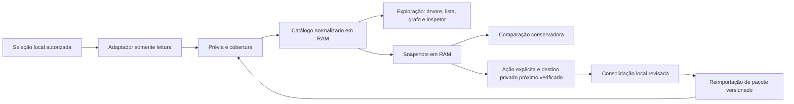

# Arquitetura proposta

Estas são fronteiras da especificação, ainda sem implementação. Stack e empacotamento serão escolhidos para sustentar os requisitos obrigatórios do [ADR-0002](adr/0002-private-local-memory.md): nenhuma externalização, RAM por padrão e consolidação explícita próxima da origem.

## Fronteiras

| Módulo | Contrato observável |
| --- | --- |
| Adaptadores | Declarar formatos, versões, capacidades e tipos; retornar itens, relações explícitas, evidências, cobertura e erros por fonte. |
| Catálogo | Preservar identidade e modalidade; reimportação idêntica não duplica registros. |
| Busca e projeções | Gerar árvore real, lista equivalente e grafo do mesmo conjunto com estado compartilhado. |
| Exploração | Manter seleção, filtros, snapshot, histórico de navegação e posições fixadas. |
| Snapshots | Manter observações, cobertura, consistência e versão do adaptador em RAM; preservar a última coleta válida durante a sessão. |
| Comparação | Usar identidade nativa confiável; expor ambiguidade e limitar conclusões quando a cobertura for incompleta. |
| Portabilidade | Consolidar e importar pacotes locais versionados com registros, relações, evidências e omissões; nunca enviar a serviços externos. |
| Estado e destino | RAM por padrão; gravar somente após ação explícita em área dedicada próxima da origem e verificada como local privada. Sem destino verificável, não gravar. |
| Isolamento | Bloquear saída externa do processo e filhos; interface e recursos empacotados localmente; impedir conteúdo privado em logs, caches e respostas do agente. |

## Contrato de fonte

Uma fonte identifica modalidade, seleção autorizada, versão do adaptador, capacidades, status e última leitura bem-sucedida. A leitura distingue sucesso completo, parcial e falha. Capacidades ausentes carregam um motivo; não são preenchidas por adivinhação.

Hash de conteúdo identifica uma versão. Identidade estável depende do contrato da fonte; correspondências ambíguas exigem indicação explícita. A primeira coleta não fornece história anterior por si só.

## Estados de experiência

Importação em andamento; fonte vazia; leitura parcial; fonte indisponível; formato incompatível; busca sem resultado; origem ausente; origem inacessível; snapshot antigo; comparação inconclusiva; seleção fora dos filtros. Cada estado deve explicar o ocorrido e uma ação disponível.

## Decisões abertas

Escolha do primeiro adaptador real, stack, plataforma, mecanismo de consolidação privada, distribuição, biblioteca de grafo e metas mensuráveis de desempenho. Nenhuma dessas decisões pode relaxar nenhuma externalização ou RAM por padrão. A condição local de um destino e os limites relacionados ao sistema operacional devem ser verificáveis antes de sustentar uma promessa de suporte.
