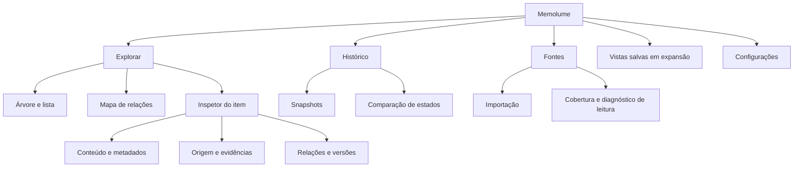

# Memolume: especificação de produto e experiência

> Brief de referência, preservado como proposta anterior ao bootstrap de 3 de outubro de 2026. Licença MIT e criação do repositório foram resolvidas no ADR-0001. Stack, plataforma e distribuição permanecem abertas. O ADR-0002 substitui as propostas históricas de dados fictícios obrigatórios, armazenamento automático e envio externo opcional: o requisito atual é validação real privada, RAM por padrão e consolidação explícita próxima da origem.

Especificação proposta do **Memolume**, uma ferramenta independente, livre e de código aberto para explorar visualmente as memórias e as estruturas de memória do ChatGPT Desktop e do Codex. O nome está definido. O documento reúne o brief de produto, o recorte da primeira versão, a arquitetura da informação, os fluxos de uso e os critérios de implementação e teste.

A experiência central é **selecionar uma memória, entender sua origem e acompanhar suas mudanças sem perder o contexto da exploração**. O produto mostra o que foi observado nas fontes acessíveis e identifica separadamente interpretações feitas pelo próprio visualizador. Esta especificação descreve comportamento a construir; integrações, interface e testes ainda não foram implementados neste trabalho.

## Problema

Quem trabalha continuamente com assistentes acumula preferências, decisões, resumos, instruções e registros distribuídos entre conversas, projetos e arquivos. Hoje, reconstruir esse conjunto exige alternar entre telas, procurar trechos e entender estruturas técnicas. É difícil responder a perguntas concretas: o que ficou registrado, de onde veio uma informação, a que projeto ela pertence e o que mudou desde a última consulta.

Um grafo que apenas aproxima textos semelhantes resolve pouco dessa dificuldade. O usuário precisa conectar conteúdo, estrutura e história, com evidências para cada relação. Também precisa distinguir uma fonte incompleta de um conjunto realmente vazio e informação armazenada de informação efetivamente usada numa resposta.

## Solução

### Brief de produto

**Nome:** Memolume.

**Descrição:** visualizador interativo da memória e da estrutura de memória dos assistentes.

**Frase de apresentação proposta:** “Explore a memória dos seus assistentes.”

**Público inicial proposto:** pessoas que usam ChatGPT Desktop e Codex em projetos recorrentes e querem compreender o contexto acumulado. Desenvolvedores e usuários avançados são uma hipótese de público de entrada; a interface deve permitir investigação sem exigir conhecimento de bancos ou formatos de arquivo.

**Trabalho principal:** encontrar uma informação e percorrer suas fontes, relações e versões para compreender o registro observado.

**Diferencial pretendido:** navegação contínua entre mapa, estrutura real, conteúdo de origem e evolução temporal, com proveniência e limites de cobertura visíveis.

**Princípios propostos:** processamento local; fontes somente leitura; nenhuma transmissão de conteúdo por padrão; formatos abertos; acessibilidade equivalente entre grafo e lista; recursos essenciais sem backend proprietário.

### Primeira versão

A primeira versão deve entregar o percurso **importação → exploração → origem → snapshots → comparação**, com um conjunto fictício disponível desde a abertura.

| Capacidade | Comportamento esperado |
| --- | --- |
| Importação | Selecionar uma fonte local ou um pacote exportado compatível, revisar a cobertura e concluir a leitura. |
| Exploração | Alternar entre árvore, lista e grafo, preservando seleção, busca, filtros e snapshot ativo. |
| Busca | Buscar texto e filtrar por fonte, projeto ou escopo conhecido, tipo e período observado. |
| Inspetor | Mostrar conteúdo, tipo, localização, relações, datas conhecidas e evidência de origem. |
| Proveniência | Percorrer vínculos explícitos até arquivos ou trechos disponíveis; identificar origem ausente ou inacessível. |
| Histórico | Criar snapshots e comparar estados observados sem inventar versões anteriores à primeira coleta. |
| Demonstração | Explorar dados fictícios com identificação persistente e separação das fontes pessoais. |
| Portabilidade | Exportar um pacote local documentado com registros, relações, evidências disponíveis e cobertura. |

Tabela analítica avançada, zoom semântico completo e investigação de contexto da sessão ficam para expansões. A primeira lista já oferece uma alternativa acessível ao grafo.

### Cobertura das integrações

A documentação diferencia memórias locais do Codex da memória usada pelo ChatGPT web e Work. O app desktop também possui controles para memórias locais. Isso exige identificar a modalidade da fonte, sem presumir um armazenamento único. Os arquivos de memória do Codex são estado gerado e sua atualização ocorre em segundo plano. [Documentação de memórias](https://learn.chatgpt.com/docs/customization/memories?surface=app).

O resumo de memória do ChatGPT pode omitir detalhes e fontes. Recursos disponíveis variam por conta e plataforma. Portanto, importar um resumo significa visualizar aquele resumo, sem afirmar cobertura total da memória. [Memória no ChatGPT](https://help.openai.com/en/articles/8590148-memory-in-chatgpt).

A exportação oficial do ChatGPT inclui histórico e outros dados da conta, mas isso não estabelece um contrato universal de exportação de memórias. O adaptador deve reconhecer o conteúdo efetivamente presente. A disponibilidade de exportação depende da conta e do workspace. [Exportação de dados](https://help.openai.com/en/articles/7260999-exporting-your-chatgpt-history-and-data).

| Fonte | Recorte proposto | Condição de entrega |
| --- | --- | --- |
| Memórias locais do Codex | Arquivos selecionados e evidências acessíveis. | Validar formatos e identidades com amostras autorizadas da versão alvo. |
| Memórias locais do app desktop | Modalidade identificada e importação por adaptador compatível. | Comprovar acesso e formato; reutilizar o adaptador Codex somente se houver equivalência demonstrada. |
| Dados exportados do ChatGPT | Conversas e demais registros reconhecidos no pacote. | Validar uma amostra autorizada; não converter automaticamente toda conversa em memória. |
| Resumo ou lista de memórias fornecidos pelo usuário | Importação de texto com modalidade e origem declaradas. | Identificar cobertura parcial e proveniência fornecida pelo usuário. |
| Instruções e fontes externas | Camadas próprias, quando incluídas na seleção. | Preservar o tipo original e os limites de acesso. |

O núcleo deve funcionar com dados fictícios e pelo menos um adaptador real validado. Compatibilidade com cada modalidade só pode ser anunciada após demonstrar importação e leitura; as demais aparecem como indisponíveis ou experimentais.

### Arquitetura da informação

**Explorar** é o destino principal. **Histórico** trata snapshots e diferenças; **Fontes** explica acesso e cobertura; **Vistas salvas** organiza percursos em uma expansão; **Configurações** reúne privacidade, armazenamento do visualizador e acessibilidade.

A tela de exploração propõe quatro regiões: navegação de fontes e estrutura à esquerda; mapa ou lista no centro; inspetor à direita; controle de snapshot e mudanças na base. Busca e filtros ficam próximos da área central. Essa composição é uma hipótese de UX a validar, sem identidade visual definitiva.

A árvore representa a hierarquia realmente observada. Grupos semânticos criados pelo Memolume aparecem numa organização separada e identificada como interpretação. O usuário pode alternar a apresentação sem confundir uma categoria visual com uma pasta ou entidade nativa.

O inspetor oferece **Conteúdo**, **Origem**, **Relações** e **Versões**. O conteúdo principal fica acessível imediatamente. Dados técnicos podem ser expandidos, incluindo localização e representação bruta. Comparar dois itens usa um modo explícito, sem substituir a seleção principal silenciosamente.

A posição de um nó indica disposição visual. Tipos de relação, rótulos e evidências explicam a conexão. Distância, tamanho e cor não representam relevância, confiança ou uso pelo assistente, salvo quando uma métrica definida e sua legenda sustentarem essa leitura.

### Fluxos de uso

#### Primeiro acesso e importação

1. O usuário escolhe **Explorar demonstração** ou **Adicionar fonte**.

2. Ao adicionar uma fonte, seleciona sua modalidade e arquivos ou pasta; o Memolume não inicia uma varredura geral do computador.

3. A prévia mostra itens reconhecidos, conteúdo ignorado, erros de acesso e capacidades disponíveis.

4. O usuário conclui a importação e vê um primeiro snapshot com data de observação e cobertura.

5. A exploração abre com grupos compreensíveis e uma sugestão de percurso: selecionar um registro e abrir sua origem.

6. Formato incompatível ou permissão insuficiente gera orientação para aquela fonte, preservando dados já importados.

A demonstração deve manter o aviso **Dados fictícios** e permitir reiniciar o percurso. Adicionar uma fonte pessoal cria um conjunto separado.

#### Encontrar e explicar uma memória

1. O usuário busca uma expressão e aplica filtros.

2. Resultados aparecem na lista e são destacados no mapa; o total descreve o conjunto filtrado.

3. Selecionar um resultado abre o inspetor e destaca o mesmo item nas outras representações.

4. **Ver origem** abre o trecho ou registro associado, mantendo a posição e os filtros.

5. O usuário percorre uma relação identificada, como “resume” ou “derivada de”, e retorna ao item anterior.

6. Se não houver vínculo, o inspetor informa **Origem não identificada**. Uma sugestão por semelhança, quando existir em expansão futura, aparece como hipótese.

**Exemplo fictício:** uma preferência por respostas curtas aponta para uma conversa apenas se essa ligação estiver registrada ou tiver sido adicionada explicitamente pelo usuário. Encontrar palavras semelhantes em outra conversa não cria uma origem confirmada.

#### Comparar dois momentos

1. O usuário abre Histórico e escolhe dois snapshots compatíveis.

2. A comparação distingue itens novos, conteúdo alterado, itens que deixaram de ser observados e correspondências incertas.

3. Selecionar uma mudança abre antes e depois, com datas, cobertura e evidência.

4. O mapa destaca alterações sem reorganizar toda a exploração desnecessariamente.

5. Uma coleta incompleta exibe o limite da comparação e não transforma ausências em exclusões.

6. Voltar ao estado atual restaura o snapshot, a seleção e os filtros anteriores.

**Exemplo fictício:** “responder de forma concisa” aparece no primeiro snapshot e “responder de forma concisa, com fontes quando necessário” no segundo. Havendo identidade estável, a UI apresenta alteração de texto. Sem identidade suficiente, apresenta uma correspondência possível a revisar.

#### Entender uma fonte vazia ou incompleta

1. O usuário vê o status da fonte: leitura concluída, parcial, indisponível ou formato incompatível.

2. Abre Fontes para consultar o que foi lido, a última leitura bem-sucedida e os motivos das lacunas.

3. Pode ajustar a seleção ou tentar novamente.

4. O último snapshot válido permanece consultável, com indicação de que não representa uma leitura atual.

5. Uma fonte removida da exploração deixa de ser consultada; snapshots já armazenados são tratados pelas opções próprias de retenção.

#### Explorar sem mouse e exportar

1. A lista permite buscar, selecionar e abrir origem usando teclado e leitor de tela.

2. Trocar entre representações conserva o item selecionado e move o foco para uma posição previsível.

3. Ao exportar, o usuário revisa o conjunto, as evidências incluídas e eventuais omissões.

4. O pacote registra versão do formato e cobertura, permitindo reimportação.

5. Uma versão de demonstração usa dados sintéticos; ocultar texto na tela não deve ser apresentado como anonimização do pacote.

### Evolução do produto

As ideias da conversa original permanecem no roteiro, com prioridade distinta do núcleo.

| Etapa | Capacidades preservadas |
| --- | --- |
| Expansão da exploração | Zoom semântico, tabela analítica, lentes por preferências e decisões, dois inspetores, vistas e percursos salvos. |
| Investigação e tempo | Atualização de fontes locais com pausa, história de decisões, comparação entre fontes e resumos, mapa de escopo e instruções. |
| Comparação e autoria | Comparação ChatGPT e Codex lado a lado, anotações e relações manuais em camada própria, pacote interativo local e modo apresentação. |
| Assistência opcional | Busca semântica e hipóteses de duplicidade, contradição ou informação antiga, sempre com evidência e revisão. |
| Contexto de sessão | Distinguir armazenamento, disponibilidade, recuperação e inclusão no contexto apenas onde registros permitirem comprovar cada estado. |

Essas expansões não são requisitos de entrega da primeira versão. Ausência num resumo não prova esquecimento; ausência de uso registrado permanece desconhecida.

## Histórias de usuário

### Primeira versão

1. Como usuário, quero iniciar com dados fictícios, para compreender o produto antes de selecionar informações pessoais.

2. Como usuário, quero escolher explicitamente uma fonte, para controlar o conjunto observado.

3. Como usuário, quero identificar a modalidade da fonte, para distinguir memória local, resumo, histórico e instruções.

4. Como usuário, quero revisar a prévia da importação, para saber o que será incluído.

5. Como usuário, quero saber quais formatos foram reconhecidos, para avaliar a cobertura.

6. Como usuário, quero ver erros por fonte, para corrigir uma leitura sem perder as demais.

7. Como usuário, quero importar sem alterar os arquivos originais, para explorar com segurança.

8. Como usuário, quero distinguir fonte vazia de leitura incompleta, para interpretar corretamente os resultados.

9. Como usuário, quero consultar a última leitura bem-sucedida, para avaliar a atualidade do conjunto.

10. Como usuário, quero explorar a estrutura realmente observada, para localizar pastas, registros e campos reconhecidos.

11. Como usuário, quero alternar entre árvore, lista e grafo, para escolher a representação útil à minha pergunta.

12. Como usuário, quero manter a seleção ao alternar de representação, para continuar a investigação.

13. Como usuário, quero buscar texto e destacar resultados no mapa, para localizar conteúdo e relações.

14. Como usuário, quero combinar filtros de fonte, tipo, escopo e período conhecido, para reduzir ruído.

15. Como usuário, quero identificar resultados excluídos pelos filtros, para entender por que um item não aparece.

16. Como usuário, quero expandir relações de um item e recolher grupos, para explorar sem carregar todo o grafo.

17. Como usuário, quero fixar posições durante a exploração, para manter referências visuais.

18. Como usuário, quero abrir o conteúdo completo no inspetor, para compreender o registro.

19. Como usuário, quero ver a localização e a representação bruta, para conferir a interpretação do adaptador.

20. Como usuário, quero percorrer vínculos explícitos de origem, para verificar o que sustenta uma informação.

21. Como usuário, quero reconhecer uma origem não identificada ou inacessível, para evitar conclusões sem evidência.

22. Como usuário, quero distinguir relações da fonte, interpretações da ferramenta e vínculos manuais, para avaliar cada conexão.

23. Como usuário, quero separar memórias, resumos, conversas e instruções em camadas, para compreender sua função.

24. Como usuário, quero identificar o escopo conhecido e os casos sem escopo informado, para evitar atribuições indevidas.

25. Como usuário, quero ver a data informada pela fonte separada da primeira observação, para interpretar a história.

26. Como usuário, quero criar snapshots locais, para preservar estados que posso comparar.

27. Como usuário, quero comparar dois snapshots, para encontrar registros novos e alterações.

28. Como usuário, quero distinguir desaparecimento observado de exclusão confirmada, para compreender as limitações da comparação.

29. Como usuário, quero revisar correspondências incertas entre versões, para evitar unir registros diferentes.

30. Como usuário, quero manter o último snapshot válido após uma falha, para continuar consultando o material.

31. Como usuário, quero operar o fluxo principal por teclado, para explorar sem depender do mouse.

32. Como usuário, quero uma lista equivalente ao grafo e relações com rótulos, para usar leitor de tela e compreender conexões.

33. Como usuário, quero reduzir movimento, para navegar confortavelmente.

34. Como usuário, quero exportar um pacote documentado e reimportável, para preservar e transportar minha investigação.

35. Como usuário, quero revisar conteúdo e evidências incluídos na exportação, para controlar o que compartilho.

36. Como usuário, quero remover dados armazenados pelo visualizador sem alterar as fontes, para gerir sua retenção.

37. Como usuário, quero usar o núcleo sem serviços remotos, para manter a exploração local.

38. Como contribuidor, quero um contrato documentado de adaptadores e exemplos fictícios, para adicionar fontes sem expor dados pessoais.

### Expansões futuras

39. Como usuário, quero zoom semântico, para passar de temas a registros sem perder o percurso.

40. Como usuário, quero lentes por preferências, decisões e projetos com inferências identificadas, para explorar por intenção.

41. Como usuário, quero comparar dois itens em inspetores simultâneos, para investigar sem alternar repetidamente.

42. Como usuário, quero salvar vistas e percursos, para retomar uma investigação.

43. Como usuário, quero acompanhar mudanças locais e pausar a atualização, para observar a evolução sem interrupções.

44. Como usuário, quero percorrer revisões documentadas de uma decisão, para compreender sua trajetória.

45. Como usuário, quero comparar um resumo com suas fontes acessíveis, para investigar o que foi condensado.

46. Como usuário, quero comparar conjuntos do ChatGPT e do Codex sem fundi-los, para identificar diferenças e temas comuns.

47. Como usuário, quero adicionar anotações e relações manuais em camada própria, para registrar minha interpretação.

48. Como usuário, quero um modo apresentação com dados fictícios ou conteúdo selecionado, para demonstrar o produto.

49. Como usuário, quero revisar hipóteses de duplicidade, contradição e informação antiga, para investigar possíveis problemas.

50. Como usuário, quero saber se há evidência de recuperação ou inclusão de um item no contexto, para avaliar o que os registros permitem afirmar.

51. Como usuário, quero ver a cadeia documentada de instruções para um escopo selecionado, para compreender sua aplicação provável.

52. Como usuário, quero ativar recursos semânticos opcionais com indicação do processamento, para decidir sobre eventuais envios externos.

## Decisões de implementação

### Estado das decisões

O nome Memolume e a finalidade de visualização interativa FOSS foram definidos pelo usuário. O modelo técnico abaixo é uma proposta para concretizar o produto. Nenhum repositório do Memolume foi vinculado a este chat e não foi encontrada uma implementação local para confrontar decisões com código, glossário ou ADRs existentes. Stack, licença específica e distribuição permanecem em aberto.

### Módulos e fronteiras

1. **Adaptadores de fonte:** detectam compatibilidade e leem apenas material selecionado. Retornam entidades, relações explícitas, evidências, cobertura e erros, sem capacidade de escrita nas fontes.

2. **Catálogo normalizado:** preserva identidades de origem, tipos, escopos e vínculos. Tipos desconhecidos permanecem desconhecidos; uma conversa importada não vira automaticamente memória.

3. **Busca e projeções:** produzem lista, árvore e grafo a partir do mesmo conjunto e estado de exploração. Agrupamentos inferidos não substituem a hierarquia original.

4. **Snapshots e comparação:** armazenam estados no espaço próprio do Memolume e calculam diferenças com regras explícitas de identidade e cobertura.

5. **Interface de exploração:** mantém seleção, filtros, vista ativa, snapshot, histórico de navegação e posição do mapa.

6. **Portabilidade:** gera e lê pacotes versionados com entidades, relações, evidências incluídas e manifestos de cobertura.

7. **Armazenamento próprio:** guarda índice e snapshots. Preferências, vistas e anotações, quando implementadas, também pertencem ao Memolume.

A implementação inicial deve preferir uma aplicação local simples e um núcleo testável, sem exigir serviços distribuídos ou múltiplos processos. Empacotamento desktop e bibliotecas de grafo serão escolhidos após validar acesso às fontes e o comportamento de navegação.

### Modelo de informação

| Entidade | Dados essenciais |
| --- | --- |
| Fonte | Identidade, modalidade, seleção autorizada, versão do adaptador, capacidades, status e última leitura bem-sucedida. |
| Item | Identidade local e nativa quando disponível, tipo, conteúdo, escopo conhecido e referência à fonte. |
| Evidência | Localizador do registro ou trecho, conteúdo observado ou referência preservada, disponibilidade e motivo de ausência. |
| Relação | Origem, destino, significado, natureza explícita ou inferida ou manual, evidência e responsável pela interpretação. |
| Snapshot | Instante de coleta, fontes incluídas, cobertura por fonte, versões observadas e resultado da leitura. |
| Mudança | Snapshots comparados, identidade correspondente, conteúdo anterior e posterior, classificação e certeza da correspondência. |

A proveniência é um campo do modelo. O inspetor deve conseguir explicar por que uma relação existe. Uma classificação sugerida deve incluir seu método e evidência; não receberá um percentual de confiança sem definição validada.

### Contrato dos adaptadores

Cada adaptador declara formatos e versões suportados, tipos de registro reconhecidos e capacidades como vínculo de origem, identidade estável, escopo e atualização observável. Capacidades não suportadas retornam ausência explícita e motivo, sem campos preenchidos por adivinhação.

A leitura retorna sucesso completo, parcial ou falha por fonte. Falha numa fonte não apaga dados válidos de outra. Reimportar a mesma versão com a mesma identidade não deve duplicar itens.

A raiz selecionada delimita a leitura. Referências ou links simbólicos fora da seleção não ampliam acesso automaticamente. Conteúdo importado é tratado como dado: texto, Markdown e links não executam instruções, scripts ou consultas.

### Identidade e evolução

A identidade nativa, quando confiável, tem precedência para acompanhar um item. Hash de conteúdo identifica uma versão, sem servir sozinho como identidade persistente de uma memória.

Quando a fonte não oferece identidade estável, o adaptador documenta a regra de correspondência e identifica ambiguidades. Mudança de localização ou texto não deve ser classificada automaticamente como exclusão seguida de criação.

Snapshots registram uma leitura consistente por fonte ou informam inconsistência. Só coleções completas e comparáveis permitem concluir que um item deixou de ser observado. A expressão “excluído na origem” exige evidência adicional.

Datas informadas, datas de modificação do arquivo e datas de observação permanecem distintas. Memolume não reconstrói uma história anterior ao primeiro snapshot sem registros fornecidos pela fonte.

### Interações e estados

Árvore, lista, grafo e inspetor compartilham a identidade selecionada. Um item oculto por filtros permanece identificado como fora do conjunto visível, com opção de revelá-lo; o sistema não seleciona outro item silenciosamente.

A abertura de um vínculo preserva o percurso de navegação. Voltar restaura seleção e filtros. Agrupamentos e expansão local limitam o volume visível; animações servem para explicar mudanças.

Estados obrigatórios incluem importação em andamento, fonte vazia, leitura parcial, fonte indisponível, formato incompatível, busca sem resultado, origem ausente, origem inacessível, snapshot antigo e comparação inconclusiva. Cada estado explica o que aconteceu e a ação disponível.

### Privacidade e extensão

O núcleo processa e armazena dados localmente, sem analytics, fontes remotas ou modelos externos obrigatórios. Excluir dados do Memolume afeta seu armazenamento; não altera a memória do assistente. A UI oferece controles separados para remover uma fonte da exploração e apagar seus snapshots.

Exportações registram o material incluído e as omissões. Ocultar um valor visualmente não elimina sua presença no arquivo. Índices, snapshots e evidências recebem os mesmos controles de retenção que o conteúdo importado.

Adaptadores contribuem por uma interface documentada e um corpus sintético. A licença livre específica deve ser escolhida antes da distribuição pública. A identificação como ferramenta independente deve permanecer na apresentação do produto.

## Decisões de teste

### Fronteira principal proposta

O teste principal atravessa o produto pelo comportamento externo: **importar um conjunto fictício → buscar → selecionar na árvore e no grafo → abrir origem → capturar outro estado → comparar → exportar → reimportar**. Essa fronteira exercita os módulos integrados sem testar a forma interna dos componentes.

O recorte de teste permanece proposto. Não há suíte ou testes anteriores do Memolume inspecionados para reutilizar. Os testes descritos aqui serão executados após a implementação.

Testes adicionais ficam nas fronteiras públicas dos adaptadores para formatos específicos e nas operações de leitura para garantir preservação das fontes. Evitar testes que apenas reproduzam estruturas internas ou posições de nós.

### Casos de aceitação

| Cenário | Resultado verificável |
| --- | --- |
| Importação válida | Itens e relações explícitas esperados aparecem com conteúdo e origem preservados. |
| Reimportação idêntica | Não cria duplicatas nem mudanças de conteúdo. |
| Fonte parcialmente ilegível | Exibe cobertura parcial, preserva resultados válidos e não indica exclusões. |
| Formato desconhecido | Informa incompatibilidade e mantém outras fontes utilizáveis. |
| Memória sem origem | Mostra ausência de vínculo; não fabrica uma conversa de origem. |
| Conversa importada | Mantém tipo conversa até existir evidência para outra classificação. |
| Texto semelhante em fontes diferentes | Preserva identidades distintas e não cria derivação confirmada. |
| Mudança com identidade estável | Apresenta antes e depois como alteração do mesmo item. |
| Identidade ambígua | Apresenta correspondência incerta sem união silenciosa. |
| Falha numa coleta posterior | Mantém o snapshot anterior e não classifica todos os registros como removidos. |
| Alternância de vistas | Preserva seleção, filtros, snapshot e acesso ao mesmo conteúdo. |
| Filtro oculta a seleção | Indica seleção fora do conjunto e permite revelá-la. |
| Retorno da origem | Restaura o percurso de exploração. |
| Pacote exportado | Reimporta conteúdo e relações declarados, com cobertura e omissões preservadas. |
| Operação somente leitura | Conteúdo, hashes e inventário dos arquivos originais permanecem intactos após o percurso. |
| Conteúdo hostil no arquivo | É exibido como dado e não executa código nem amplia a seleção de leitura. |
| Demonstração | Mantém identificação de dados fictícios e separação das fontes pessoais. |
| Operação offline | O fluxo principal termina sem conexão ou chamadas externas. |
| Retenção | Apagar dados do visualizador remove os dados escolhidos e preserva a fonte original. |
| Acessibilidade | O percurso principal funciona por teclado, com foco visível, leitura dos rótulos e alternativa em lista. |

Verificação visual deve abranger a largura desktop alvo, uma janela estreita, conteúdo longo, grafos densos, foco por teclado e redução de movimento. A alternativa em lista não pode ser uma representação incompleta do conteúdo disponível no mapa.

Desempenho será medido com conjuntos sintéticos de tamanhos documentados. A entrega deve demonstrar que busca, seleção e expansão local permanecem utilizáveis no tamanho declarado; limites e tempos numéricos precisam ser definidos com a stack e medidos, sem promessas antecipadas.

### Critério de conclusão da primeira versão

O percurso central deve funcionar com a demonstração e com pelo menos um adaptador real validado, preservando as fontes. Seleção sincronizada, origem conhecida ou ausência explícita, snapshots comparáveis, exportação reimportável e estados de falha devem cumprir os casos acima.

A lista de compatibilidade deve corresponder aos adaptadores efetivamente demonstrados. Especificação publicada, protótipo navegável e integração real validada são entregas diferentes.

## Fora de escopo

- Editar, apagar ou sincronizar diretamente a memória original do ChatGPT ou do Codex.

- Prometer visibilidade de todo o conhecimento interno ou de toda influência numa resposta.

- Depender de APIs privadas, captura de credenciais ou manipulação de bancos internos não validados.

- Recuperar conversas apagadas ou reconstruir histórico inexistente.

- Tratar semelhança semântica como proveniência confirmada.

- Apresentar diagnósticos de contradição, duplicidade ou obsolescência como conclusões automáticas.

- Exigir IA externa, conta proprietária ou serviço pago para o fluxo principal.

- Entregar nesta primeira versão colaboração em nuvem, publicação pública de memórias ou edição dos assistentes.

- Incluir as expansões do roteiro como critérios de aceitação do núcleo.

- Implementar todos os sistemas operacionais antes de validar a plataforma inicial.

## Notas adicionais

### Decisões abertas

Stack, licença livre específica, plataforma inicial e forma de distribuição ainda não foram escolhidas. Um início orientado ao desktop é coerente com o objetivo; macOS é uma possibilidade a validar, sem compromisso registrado nesta especificação.

O suporte real ao ChatGPT Desktop depende de identificar a modalidade de memória desejada e validar uma amostra autorizada. A disponibilidade de uma estrutura no Codex não prova equivalência com outras modalidades.

Memolume é o nome escolhido. Threadglass e Memorama ficam apenas como alternativas anteriores; não são módulos ou submarcas. Disponibilidade de domínio, repositório e marca não foi pesquisada neste trabalho.

### Ordem proposta de implementação

1. **Validar uma fonte e o contrato:** escolher um adaptador inicial, reunir amostras autorizadas e sintéticas, demonstrar leitura e documentar cobertura.

2. **Entregar exploração com origem:** importar, buscar, navegar na árvore, lista e grafo e abrir evidências, com estados vazios e de falha.

3. **Entregar evolução e portabilidade:** snapshots, comparação conservadora, exportação e reimportação completam a primeira versão.

4. **Expandir com evidência de uso:** priorizar zoom semântico, vistas salvas e atualização local antes de classificação assistida.

O primeiro marco útil é uma demonstração em que uma pessoa encontra uma memória e entende sua origem. O segundo mostra como ela mudou entre duas observações. A validação com usuários deve verificar se conseguem explicar o que a fonte sustenta e identificar o que permanece desconhecido.

### Referências

- [Memórias no ChatGPT Desktop e no Codex](https://learn.chatgpt.com/docs/customization/memories?surface=app), consultada em 3 de outubro de 2026.

- [Memória no ChatGPT](https://help.openai.com/en/articles/8590148-memory-in-chatgpt), consultada em 3 de outubro de 2026.

- [Exportação do histórico e dos dados do ChatGPT](https://help.openai.com/en/articles/7260999-exporting-your-chatgpt-history-and-data), consultada em 3 de outubro de 2026.

- [Instruções com AGENTS.md](https://learn.chatgpt.com/docs/agent-configuration/agents-md): referência para a expansão de visualização da cadeia de instruções. A existência de arquivos não prova sua inclusão numa sessão; configuração e evidência da sessão precisam sustentar essa conclusão.
